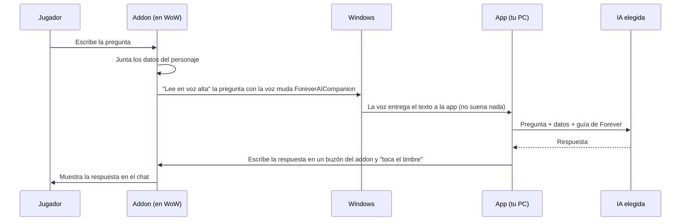

<p align="center">
  
</p>

<h1 align="center">Forever AI Companion</h1>

<p align="center">
  Tu asistente con IA dentro de <b>World of Warcraft: Forever</b>.<br>
  Pregunta lo que quieras sin salir del juego: la IA ya conoce a tu personaje.
</p>

<p align="center">
  <a href="https://github.com/lucasmenares/forever-ai-companion/releases/latest/download/ForeverAICompanion.exe"><b>⬇ Descargar para Windows</b></a>
</p>

---

## Contenido

- [Qué es](#qué-es)
- [Instalación (3 minutos)](#instalación-3-minutos)
- [Cómo se usa en el juego](#cómo-se-usa-en-el-juego)
- [Qué IA elegir](#qué-ia-elegir)
- [Cómo funciona por dentro](#cómo-funciona-por-dentro)
- [La guía de WoW Forever y sus actualizaciones](#la-guía-de-wow-forever-y-sus-actualizaciones)
- [Privacidad y seguridad](#privacidad-y-seguridad)
- [Preguntas frecuentes y problemas](#preguntas-frecuentes-y-problemas)
- [Desinstalar](#desinstalar)
- [Para desarrolladores](#para-desarrolladores)

---

## Qué es

Forever AI Companion son dos piezas que trabajan juntas:

| Pieza | Dónde vive | Qué hace |
|---|---|---|
| **El addon** | Dentro de WoW Forever | El botón flotante, la ventana de chats y el asistente. Lee los datos de tu personaje y muestra las respuestas. |
| **La app** (`ForeverAICompanion.exe`) | En tu PC con Windows | Recibe tu pregunta, se la hace a la IA que elegiste y devuelve la respuesta al juego. |

Con cada pregunta la IA recibe, sin que tengas que explicarlo:

- tu **personaje**: raza, clase, nivel, experiencia, talentos y estadísticas;
- tu **equipo** pieza por pieza, lo que llevas en las **bolsas** y en el banco;
- **dónde estás**: zona y coordenadas;
- tus **misiones** con su progreso, recompensas y las coordenadas reales de dónde hacerlas;
- **profesiones**, reputaciones, mazmorras con bloqueo, grupo y objetivo.

Así puedes preguntar cosas como *"¿Qué hago ahora?"*, *"¿Me sirve este anillo?"* o *"¿Qué mazmorra me conviene?"* y recibir una respuesta pensada para **tu** personaje.

Te responde un asistente con personalidad: **Fizzi**, una inventora gnoma, para la Alianza, o **Rizzik**, un negociante goblin, para la Horda.

---

## Instalación (3 minutos)

**Requisitos:** Windows 10 u 11, WoW Forever instalado y una IA (abajo se explica cuál elegir: si tienes Claude Pro/Max o ChatGPT Plus/Pro, no pagas nada extra).

### 1. Descarga y abre la app

1. Descarga [**ForeverAICompanion.exe**](https://github.com/lucasmenares/forever-ai-companion/releases/latest/download/ForeverAICompanion.exe).
2. Haz doble clic en el archivo.

> **¿Aparece "Windows protegió su PC"?** Es normal en programas nuevos que todavía no tienen firma digital. Pulsa **Más información** y luego **Ejecutar de todas formas**.

La app se instala sola en tu usuario (sin pedir permisos), crea el acceso directo **Forever AI Companion** en el escritorio y en el menú Inicio, y abre su ventana. Después puedes borrar el archivo descargado.

### 2. Sigue el asistente de la app

La ventana te guía paso a paso:

| Paso | Qué hacer |
|---|---|
| **Tu juego** | Normalmente encuentra WoW Forever solo. Si no, pulsa **Elegir carpeta…** y elige la carpeta *World of Warcraft*. |
| **El addon** | Pulsa **Instalar el addon**. |
| **Tu IA** | Elige quién responde (ver [Qué IA elegir](#qué-ia-elegir)), sigue los pasos que aparecen y pulsa **Guardar y probar**: verás una respuesta de ejemplo. |
| **Envío invisible** (opcional, recomendado) | Elige cómo viaja tu pregunta del juego a la app ([más abajo](#cómo-viaja-tu-pregunta-invisible-o-línea-en-pantalla) se explica). |
| **Listo** | Deja activado **Abrir al iniciar Windows** para no tener que acordarte de abrir la app. |

### 3. Reinicia WoW

Si el juego estaba abierto, **ciérralo por completo y vuelve a abrirlo** (con `/reload` no basta la primera vez).

### Actualizar

Descarga el `.exe` nuevo y ábrelo: reemplaza la versión anterior y actualiza el addon solo, sin perder tus chats ni tu configuración. La guía de WoW Forever que usa la IA se actualiza sola desde internet, sin descargar nada.

---

## Cómo se usa en el juego

1. **Pulsa el botón flotante**: el círculo con el retrato de tu asistente, arriba a la derecha junto al minimapa. Puedes arrastrarlo.
2. **La primera vez elige a tu asistente**: Fizzi (Alianza) o Rizzik (Horda). Te sugiere el de tu facción.
3. **Escribe tu pregunta** y pulsa Enviar. En unos segundos llega la respuesta; si tenías la ventana cerrada, te llega un aviso.

- **Chats por tema**: cada chat recuerda su conversación (equipo, misiones, mazmorras…). Clic derecho en el botón flotante abre un chat nuevo.
- **Ver qué se envía**: en la ventana pulsa **Ver los datos que envío**.
- **En combate** no se puede preguntar (a propósito): espera a salir.

### Comandos de chat (opcionales)

| Comando | Qué hace |
|---|---|
| `/ia` | Abre o cierra la ventana |
| `/ia <pregunta>` | Pregunta directo en el chat abierto |
| `/ia nuevo` | Crea un chat nuevo |
| `/ia asistente` | Elige entre Fizzi y Rizzik (`/ia asistente fizzi` o `/ia asistente rizzik`) |
| `/ia boton` | Muestra u oculta el botón flotante (`/ia boton reset` lo devuelve a su lugar) |
| `/ia sonido` | Activa o silencia el aviso de respuesta |
| `/ia datos` | Muestra los datos que se envían |
| `/ia estado` · `/ia buzon` | Diagnóstico: estado de la conexión y revisar respuestas pendientes |
| `/ia ayuda` | Lista de comandos |

---

## Qué IA elegir

| Opción | Para quién | Costo | Busca en internet |
|---|---|---|---|
| **Mi suscripción de Claude** (recomendado) | Tienes Claude Pro o Max | Incluido en tu plan | Sí |
| **Mi suscripción de ChatGPT** | Tienes ChatGPT Plus o Pro | Incluido en tu plan | Sí |
| **Claude con clave de API** | Sin suscripción | Pagas por uso (≈ 1 centavo de dólar por pregunta) | Sí |
| **ChatGPT con clave de API** | Sin suscripción | Pagas por uso | No |
| **Gemini** | Quieres probar gratis | Uso gratuito con límites | No |
| **IA en tu PC (Ollama)** | Tienes un PC potente | Gratis, sin internet | No |
| **Modo prueba** | Comprobar que el juego y la app se conectan | Gratis (no es una IA) | — |

Con las suscripciones, la app instala el programa oficial (**Claude Code** de Anthropic o **Codex** de OpenAI) y abre tu navegador para iniciar sesión. Tus preguntas cuentan para el límite de uso de tu plan.

Puedes cambiar de IA o de modelo cuando quieras desde el panel de la app (**Cambiar**, al lado de *Inteligencia artificial*).

---

## Cómo funciona por dentro

Por seguridad, los addons de WoW **no pueden usar internet ni escribir archivos**. Por eso la pregunta necesita un camino para salir del juego y la respuesta otro para volver:



### Ida: del juego a la app

1. El addon junta tu pregunta y los datos del personaje en un JSON. Para que sea liviano, las secciones que no cambiaron desde la última pregunta (equipo, talentos…) se envían solo como una huella, y la app las completa desde su copia.
2. Lo empaqueta con una marca `AZIA`, su largo y una suma de control, y lo envía por uno de dos caminos:

#### Cómo viaja tu pregunta: invisible o línea en pantalla

| | **Invisible** (recomendado) | **Línea en pantalla** |
|---|---|---|
| Cómo funciona | Windows tiene voces para leer texto en voz alta (como el Narrador). La app agrega una voz **muda** llamada *ForeverAICompanion*. El addon "lee" tu pregunta con esa voz y, en lugar de sonar, la voz se la entrega a la app. | El addon dibuja durante ~0,35 s una línea delgada de cuadritos oscuros en el borde superior. La app la lee de la ventana del juego, como un código QR. |
| Qué se ve o se oye | Nada | Un parpadeo breve arriba de la pantalla |
| Requisitos | Un permiso de administrador una sola vez (Windows solo deja agregar voces así) | WoW visible al preguntar (no minimizado ni tapado) |
| Qué se instala | Una voz silenciosa en la lista de voces de Windows | Nada |

Técnicamente, la voz es un pequeño motor SAPI que la app compila en tu PC con el compilador de C# incluido en Windows. Cuando el juego le pide hablar, guarda el texto en `%APPDATA%\AzerothIA\tts-inbox\` en vez de generar audio. Los mensajes van en trozos de hasta 16.000 caracteres (`AZIA:<id>:<parte>/<total>:<datos>`) y la app los vuelve a unir.

### Vuelta: de la app al juego

- Al instalar el addon se crean **50 addons "buzón"** (`AzerothIA_S01` … `S50`) que el juego carga solo cuando se le pide. La app escribe las respuestas en ellos.
- Para avisar que hay respuesta, la app "toca un timbre": 500 archivos `sig/NNN.wav` empiezan vacíos y la app convierte el siguiente en un sonido mudo de 50 ms. Cada 2 segundos el addon intenta reproducirlo; si se puede, lo corta al instante y carga el siguiente buzón, que lee la respuesta recién escrita.
- Cada buzón se puede cargar una vez por sesión (por eso hay 50; con `/reload` se reinician). Si el sonido del juego está desactivado, el addon revisa los buzones con un temporizador.

Esto explica por qué hay que **reiniciar WoW** después de instalar: el juego solo ve los archivos que existían al arrancar.

### Qué recibe la IA

- **Las instrucciones del asistente**: personalidad de Fizzi o Rizzik, cómo leer los datos y cómo responder (breve, con coordenadas, sin enlaces porque el juego no puede abrirlos).
- **La fecha de hoy y la versión del juego**, para razonar sobre el calendario y los parches.
- **La guía de WoW Forever** (ver abajo).
- **Tus datos y la pregunta**, más las preguntas anteriores del mismo chat.
- Si la IA puede, **busca en internet** cuando necesita un dato propio de Forever (unos segundos más). Se puede desactivar en el panel.

Con las suscripciones, Claude Code y Codex se ejecutan como un chat simple: nuestras instrucciones reemplazan las suyas de programación, sin acceso a tus archivos ni a comandos, sin tu configuración y sin guardar sesiones.

---

## La guía de WoW Forever y sus actualizaciones

WoW Forever salió el 4 de noviembre de 2026, después de que se entrenaran las IA, así que no lo conocen de memoria. Por eso la IA recibe una **guía base de Forever**: zonas, mazmorras con sus niveles, bandas, la raza Cielonata, cambios de sistemas y calendario.

La guía es el archivo [`companion/knowledge-builtin/wow-forever.md`](companion/knowledge-builtin/wow-forever.md) de este repositorio. Empieza con un encabezado:

```
---
fecha: 2026-11-13       ← cuándo se revisó por última vez
versionJuego: 1.60.1    ← versión del juego que describe
build: 70938            ← número de compilación del juego
---
```

**Cómo se mantiene al día:**

- La app trae una copia, y además **descarga la de este repositorio** al iniciar, cada 6 horas y apenas detecta que el juego se actualizó. Solo la usa si es válida y su `fecha` es más nueva; sin conexión usa la última que descargó.
- La IA sabe la fecha de hoy y la antigüedad de la guía. Si la guía tiene más de 21 días, o el juego es más nuevo que la guía, comprueba en internet lo que cambia con los parches antes de afirmarlo.

**Para actualizar la guía de todos los jugadores** (sin publicar una versión nueva de la app):

1. Abre [`companion/knowledge-builtin/wow-forever.md`](companion/knowledge-builtin/wow-forever.md) en GitHub y pulsa el lápiz (*Edit*).
2. Haz los cambios y **cambia la `fecha`** a la de hoy (y `versionJuego` y `build` si hubo parche; el build se ve con `/ia datos` en el juego, sección *client*).
3. Pulsa **Commit changes**. En unas horas todas las apps lo descargan (o al pulsar **Buscar actualización** en el panel).

Consejos para la guía: escribe fechas completas ("abrieron el 9 de diciembre de 2026", no "abren pronto"), marca con "según guías" lo que no está confirmado por Blizzard y mantenla por debajo de 200 KB.

Además, cada jugador puede agregar su propio conocimiento en el panel de la app (**Conocimiento del servidor…**): los archivos `.md` o `.txt` de esa carpeta se incluyen en cada pregunta y tienen prioridad sobre la guía.

---

## Privacidad y seguridad

- **Tus datos solo van a la IA que elegiste.** Este proyecto no tiene servidores: no recibe tus preguntas, tus datos ni tus claves.
- La única conexión propia de la app es descargar la guía de Forever desde este repositorio (una lectura, sin enviar nada).
- Las claves de API se guardan solo en tu PC, en `%APPDATA%\AzerothIA\config.json`.
- La ventana de la app es una página local (`127.0.0.1`) que no acepta conexiones de otros equipos ni de otras páginas web.
- **El juego no se modifica**: no se toca su memoria ni sus archivos, y el addon no juega por ti. Solo se usan funciones normales de los addons y de Windows.
- No es un producto de Blizzard. Úsalo bajo tu responsabilidad.

---

## Preguntas frecuentes y problemas

**¿Cuánto cuesta?**
La app es gratis. Con tu suscripción de Claude o ChatGPT no pagas nada extra (las preguntas cuentan para el límite de tu plan). Con una clave de API pagas según el uso.

**No llega la respuesta.**
- Abre la app y mira que arriba diga **Funcionando**.
- Si acabas de instalar el addon o el envío invisible, cierra WoW por completo y vuelve a abrirlo.
- Escribe `/ia buzon` en el juego para revisar si hay respuestas nuevas.
- Si usas la línea en pantalla, WoW tiene que estar visible al preguntar y en modo ventana o "pantalla completa (ventana)".

**No veo el botón flotante.**
Puede que lo hayas ocultado (Shift + clic derecho). Escribe `/ia boton`, o `/ia boton reset` para devolverlo a su lugar.

**La prueba de la IA falla.**
Revisa los pasos del paso *Tu IA*: que el programa esté instalado y con la sesión iniciada, o que la clave esté completa. El mensaje de error explica qué falta.

**¿La app tiene que estar abierta?**
Sí, mientras juegas. Al cerrar su ventana puede seguir funcionando junto al reloj de Windows (clic en el ícono para volver a abrirla; clic derecho para cerrarla). Con **Abrir al iniciar Windows** no tienes que acordarte.

**¿Funciona en Mac?**
No por ahora: solo Windows 10 y 11.

---

## Desinstalar

Abre la app y, en **Más opciones**, pulsa **Desinstalar**. Se borran el addon, los buzones, la voz invisible, tu configuración, los accesos directos y el programa.

---

## Para desarrolladores

> El nombre interno del proyecto es **AzerothIA** (su primer nombre). Se mantiene en la carpeta del addon, la carpeta de datos (`%APPDATA%\AzerothIA`) y la carpeta de instalación para que las actualizaciones conserven chats, configuración y el envío invisible.

### Estructura

```
addon/AzerothIA/            Addon (Lua 5.1, cliente moderno, interfaz 16001)
  Collect.lua               Lee los datos del personaje (cada sección por separado)
  Uplink.lua                Juego → app: arma el paquete y elige el camino
  Voice.lua                 Camino invisible (texto a voz con la voz muda)
  Live.lua                  App → juego: buzones y timbre
  UI.lua Button.lua         Ventana de chats y botón flotante
  Chats.lua Notify.lua      Conversaciones y avisos
  Personas.lua              Fizzi y Rizzik
  Core.lua                  Eventos y comandos /ia
companion/
  src/app/                  App: main (autoinstalación, bandeja), controller,
                            server (ventana local), system (Windows), ui.html
  src/watcher.js            Recibe preguntas y publica respuestas
  src/voice-inbox.js        Lee lo que entrega la voz muda
  src/screen-reader.js      Lee la línea en pantalla
  src/grid.js image.js      Decodifica la línea
  src/inbox.js              Buzones y timbre
  src/prompt.js             Instrucciones para la IA
  src/guide.js              Guía de Forever: fecha, versión y descargas
  src/providers.js          Claude, OpenAI/Gemini/Ollama, Claude Code, Codex, prueba
  src/codex.js              Codex: instalación, sesión y ejecución
  src/claude-code.js        Claude Code: instalación y sesión
  src/tts-voice.js          Instala la voz muda
  tts/AzerothIATts.cs       Motor de la voz muda (C#)
  tray/Tray.cs              Ícono junto al reloj (C#)
  knowledge-builtin/        Guía de WoW Forever
  scripts/build.js          Empaqueta ForeverAICompanion.exe
  test/                     Pruebas (ejecutan el Lua real del addon)
```

### Compilar y probar

Requisitos: Windows y Node.js 25.5 o superior (para `--build-sea`; para desarrollar basta Node 22).

```bash
cd companion
npm install
npm test            # pruebas
npm run app         # la app con su ventana, desde el código
npm run build       # genera dist/ForeverAICompanion.exe
```

El `.exe` es un único ejecutable (Node SEA) que incluye Node.js, la app, el addon, la guía y los íconos. Los ayudantes en C# (voz muda y bandeja) se compilan en el PC del jugador con el compilador de .NET Framework incluido en Windows.

Modo terminal, sin ventana:

```bash
npm run install-addon -- --wow "C:\ruta\World of Warcraft\_forever_"
npm start
npm run ask -- "¿Qué mazmorra me recomiendas?"
```

Variables para pruebas: `AZIA_DATA_DIR` (carpeta de datos), `AZIA_WOW_DIR`, `AZIA_PROVIDER`, `AZIA_NO_SHORTCUTS`. Argumentos del `.exe`: `--no-install`, `--no-window`, `--background`.

### Publicar una versión nueva

1. Sube el número en `companion/src/app/controller.js` (`VERSION`) y, si cambió el addon, en `addon/AzerothIA/AzerothIA.toc`.
2. `npm test` y `npm run build`.
3. En GitHub, **Releases → Draft a new release**, crea la etiqueta (por ejemplo `v1.5.0`) y adjunta `dist/ForeverAICompanion.exe` con ese nombre exacto: el enlace de descarga de este README siempre apunta al último.

### Pendiente

- **Firma digital** del `.exe` para quitar el aviso de SmartScreen (certificado de firma de código o Azure Trusted Signing).
- Revisar las políticas de Blizzard para Forever antes de una distribución amplia.
